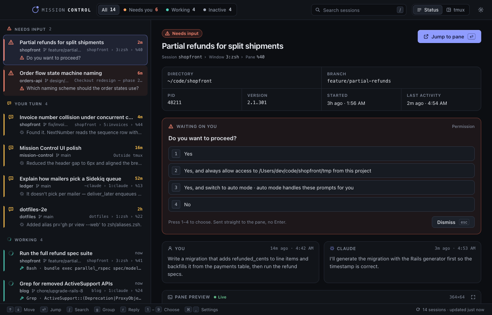

# Mission Control

*One board for every Claude Code session you have running.*



A small [Tauri](https://tauri.app) desktop app for macOS that finds every Claude Code session
across your tmux sessions and shows them in one window: which ones are waiting on a menu, which
ones finished and owe you a reply, which are working, and which have gone quiet. Pick one to see
its last prompt, its last reply, the tool it is running and a live preview of its pane. From there
you can answer a permission prompt or an AskUserQuestion menu, type a reply, or jump your
terminal straight to the pane.

It only reads what Claude Code and tmux already expose (the session registry, transcripts,
`tmux list-panes` and `capture-pane`). Answers go in through `tmux send-keys`, the same as if you
had typed them in the pane.

## Setup

```sh
bin/setup
```

Installs the toolchain (Xcode Command Line Tools, mise, the pinned Rust, the Tauri CLI, tmux and
terminal-notifier) and warms the build cache. Safe to re-run.

Rust and Node versions are pinned in `mise.toml`, and every `bin/` script goes through
`mise exec`, so the build doesn't depend on whichever Rust happens to be on your `PATH`.

## Run it

```sh
bin/run
```

Runs `cargo tauri dev`. Sessions show up within a couple of seconds of the window opening.

## Install a release build

For day-to-day use, build the optimized app and launch it from a terminal instead of running the
dev server:

```sh
bin/build     # release build → src-tauri/target/release/bundle/macos/MissionControl.app
bin/install   # add a `mission-control` shell function to ~/.zshrc (skips if already present)
```

After that, `mission-control` (in a new shell, or after `source ~/.zshrc`) opens the built app
from anywhere. Re-run `bin/build` to pick up changes; the function always launches the latest
build.

## How it decides what a session is doing

Every 2 seconds the backend joins four sources:

- **`~/.claude/sessions/<pid>.json`**, Claude Code's registry of running processes, with the
  status hook's `busy` / `idle` / `waiting` and the tmux pane it started in. Files for dead or
  reused pids are skipped.
- **`tmux list-panes -a`**. A Claude pane's command is its version number (`2.1.301`). A registry
  entry is only joined to a pane that is running Claude, so a session you suspended with Ctrl+Z
  (the pane now runs zsh) can't be typed into.
- **`tmux capture-pane`** of each Claude pane, to spot an open menu and read its question and
  options. A menu counts only when it carries Claude Code's key-hint footer ("Esc to cancel",
  "Enter to select") and has no input box below it, so a numbered list you typed as a prompt
  isn't mistaken for one.
- **The transcript tail** (`~/.claude/projects/*/<sessionId>.jsonl`) for the last prompt, last
  reply and the tool in flight.

That gives one of five states: **needs input** (a menu is open), **your turn** (Claude replied
after your last prompt), **working**, **idle**, or **unknown** (a Claude pane with no registry
entry). Idle and your-turn sessions older than the stale threshold (8 hours by default) are
grouped as stale. The full rules are in [docs/CONTRACT.md](docs/CONTRACT.md).

Before anything is sent to a pane, the backend checks that pane again: it must still run Claude,
hold the same session, be in the state you saw and, for a menu, show the same question and
options. Otherwise nothing is sent and the UI says the session changed.

## Keyboard

| Key | Does |
|---|---|
| `↑` / `↓`, `j` / `k` | Move the selection |
| `Enter` | Jump the terminal to the selected pane |
| `1`–`9` | Choose that menu option (sent straight to the pane, no Enter) |
| `Esc` | Close the dialog, leave the reply box, clear the search, unfocus a button; with nothing else to do, dismiss the open menu |
| `r` | Focus the reply box |
| `⌘⏎` | Send the reply |
| `/` | Search titles, projects, branches, tmux sessions, directories and prompts |
| `g` | Toggle grouping: by status or by tmux session |
| `⌘R` | Refresh now |
| `⌘,` | Settings |
| `⌘W` | Hide the window |

If the session you had selected leaves the list (it finished, or a filter hid it), the selection
moves to its neighbour, but `1`–`9` and `Esc` stay off until you select that session yourself.
That way a second keypress can't answer a prompt you haven't read.

## Menu bar, hotkey and notifications

- **Menu bar:** the icon's count is the number of sessions that need input or owe you a reply.
  Left click shows or hides the window. Right click lists those sessions (menus first, newest
  first); pick one to jump to it.
- **Global hotkey:** `Ctrl+Alt+M` by default (change it in Settings). It shows and focuses the
  window, or hides it if it's already in front. Closing the window hides it; quit from the menu
  bar or with `⌘Q`.
- **Notifications** go through terminal-notifier: "Your turn" when a session finishes working
  (on by default), and "Needs input" when a menu opens (off by default, since a Claude Code
  Notification hook usually covers that already).

The board keeps polling while the window is hidden, so the menu bar and notifications stay
current. The pane preview pauses while the window is hidden.

## Working on the UI in a browser

The UI is plain JavaScript with no bundler, and a mock Tauri bridge lets you run it in any
browser against sample data:

```sh
python3 -m http.server 8765        # from the repo root
open http://localhost:8765/test/harness/
```

The harness loads the real `src/index.html`, serves `test/fixtures/snapshot.json` as the
snapshot (timestamps shifted to "just now") and the real pane captures in
`src-tauri/tests/fixtures/` as previews. Working sessions tick every 2 seconds. Query parameters
switch scenarios: `?state=empty`, `?state=notmux`, `?state=error`, `?state=loading`,
`?reply=state_changed`, `?jump=fail` and `?hidden=1`. See `test/harness/mock-tauri.js`.

## Tests

```sh
npm test                                                     # UI logic (node:test)
mise exec -- cargo test --manifest-path src-tauri/Cargo.toml # backend
mise exec -- cargo clippy --manifest-path src-tauri/Cargo.toml --all-targets -- -D warnings
mise exec -- cargo fmt --manifest-path src-tauri/Cargo.toml --check
```

Backend tests run against a fake tmux and never touch your real panes. Menu detection is tested
against raw captures in `src-tauri/tests/fixtures/*.ansi`. One ignored test prints a read-only
snapshot of your real sessions:

```sh
mise exec -- cargo test --manifest-path src-tauri/Cargo.toml live -- --ignored --nocapture
```

## Notes and known limits

- **macOS only** in practice: jumping uses `osascript` to raise your terminal (iTerm by default,
  set in Settings), and the pid check uses `proc_name`.
- **Sessions outside tmux** are listed from the registry but can't be previewed, answered or
  jumped to.
- **The trust dialog**, and any menu that doesn't parse, can only be answered in the pane:
  Mission Control shows a Jump button instead of options.
- **Replies are one line.** Line breaks and tabs are sent as spaces, since a raw newline would
  submit early.
- **Detection reads the screen.** If Claude Code changes how its menus or footers look, menus
  may stop being recognized (the session still shows as needing input when the registry says
  `waiting`, just without options).
- **Long menu labels** that wrap are cut to their first line.
- A Claude pane with no registry entry shows as `unknown` with no last-activity time.
